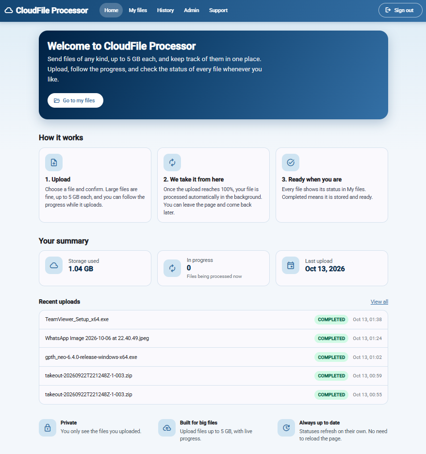
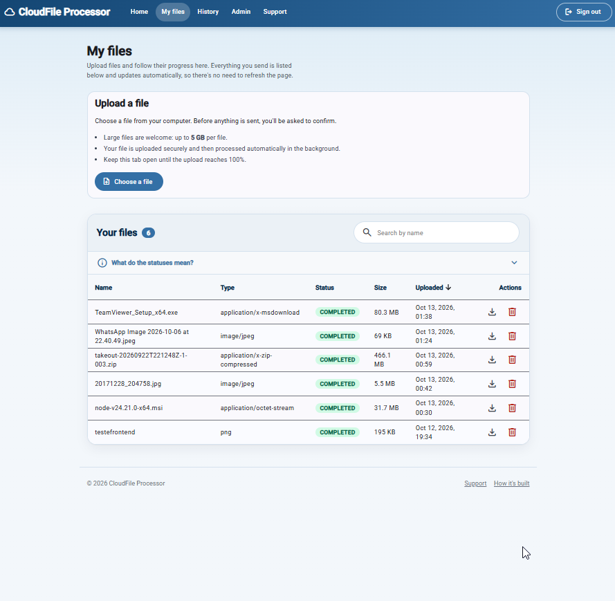
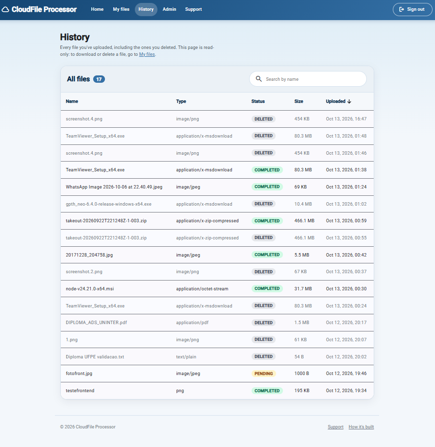
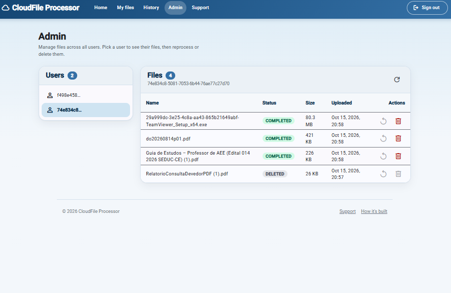
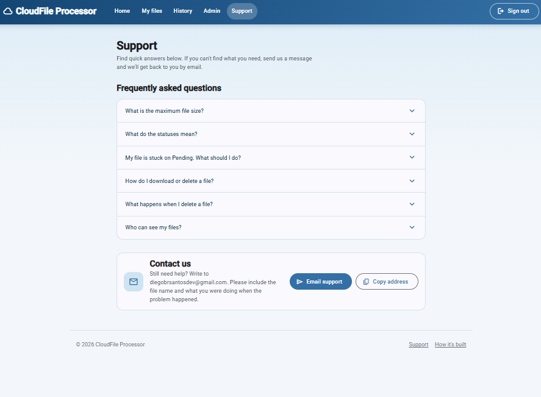
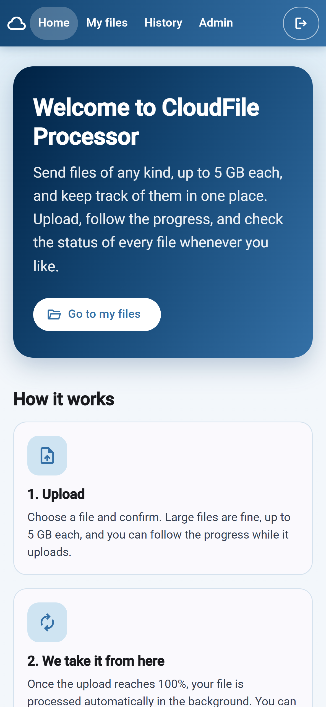
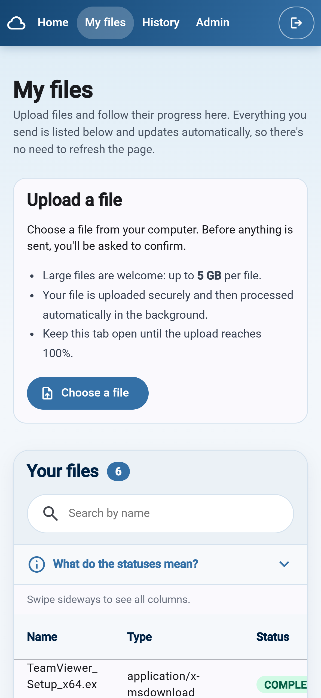
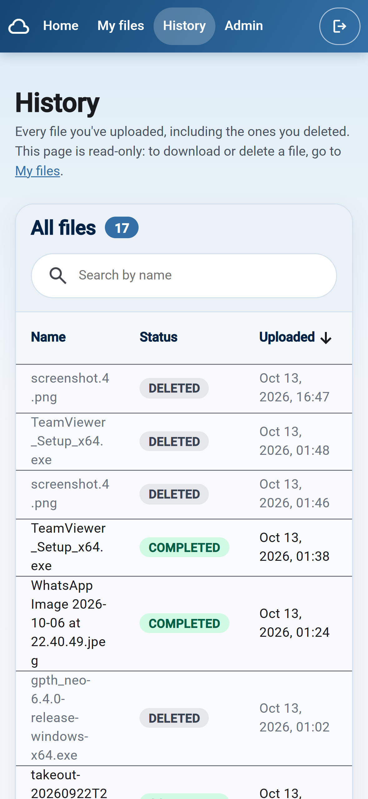
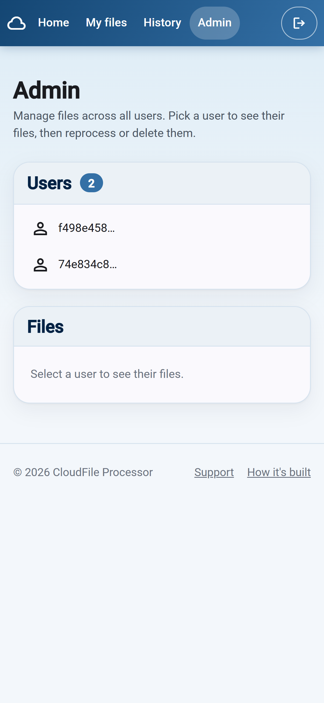
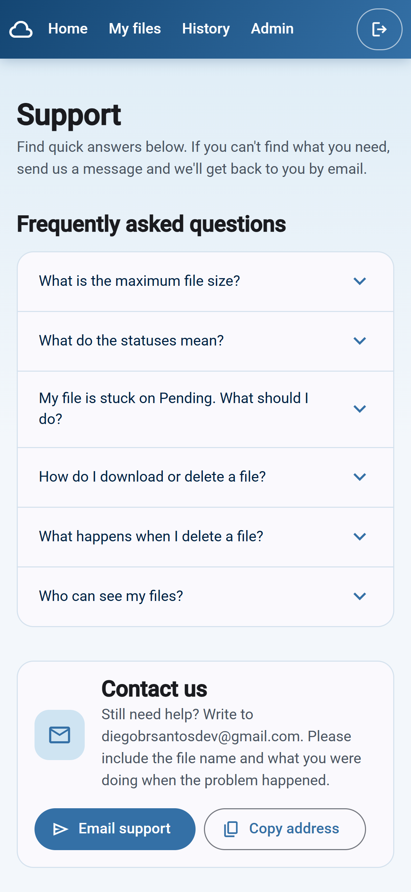

# CloudFile Processor: Web App


Angular front end for [CloudFile Processor](https://github.com/diegobrsantosdev/cloudfile-processor), a cloud-native file processing system built with Java, Spring Boot and AWS. Users sign in, upload files of up to 5 GB straight to Amazon S3, follow their processing status and manage their files.

<!-- Demo video: add the link here -->

## Screenshots

<details>
<summary><strong>Click to see the screenshots</strong></summary>

<br />

**Home**



**My files**



**History**



**Admin**



**Support**



**Mobile**

<table>
  <tr>
    <td align="center"><b>Home</b><br /></td>
    <td align="center"><b>My files</b><br /></td>
    <td align="center"><b>History</b><br /></td>
  </tr>
  <tr>
    <td align="center"><b>Admin</b><br /></td>
    <td align="center"><b>Support</b><br /></td>
    <td></td>
  </tr>
</table>

</details>

## Features

- **Sign in with Amazon Cognito** using the Hosted UI (OpenID Connect, Authorization Code with PKCE).
- **Home** with a storage summary, files in progress and the 5 most recent uploads.
- **My files**: upload with a confirmation dialog and a real progress bar, search, sortable table, download, delete with confirmation, and automatic status refresh while files are being processed.
- **History**: every file ever uploaded, including deleted ones.
- **Admin** (only for the Cognito `ADMIN` group): browse users and their files, reprocess failed files, delete files.
- **Support** page with an FAQ and email contact, and a **How it's built** page.
- Responsive layout, friendly error messages that use the backend's error responses, and English copy written for end users.

## How it works

```
Browser (Angular SPA)
  ├─ 1. Sign in ─────────────────► Amazon Cognito Hosted UI (OIDC + PKCE)
  ├─ 2. API calls + Bearer token ─► Spring Boot API
  │       POST /files returns a pre-signed upload URL
  └─ 3. PUT file to that URL ─────► Amazon S3 ─► SQS ─► worker (processing)
```

Key decisions:

- **Direct upload to S3.** Files never pass through the API. The browser sends them with `XMLHttpRequest`, because `fetch` cannot report upload progress.
- **The token only goes to the API.** The HTTP interceptor adds the Bearer token to requests for the API base URL and never to the pre-signed S3 URLs.
- **Public OIDC client with PKCE.** No client secret exists in the browser.
- **Status refresh.** The files page polls while any file is `PENDING` or `PROCESSING`, and for 60 seconds after an upload.
- **Role-based UI.** The Admin link and route depend on the `cognito:groups` claim. This is only a convenience: the backend enforces permissions.
- **Size guard.** Files above 5 GB are rejected in the browser, because that is the limit of a single S3 upload.
- **Design tokens.** Colors, corner radius and gradients live in `src/material-theme.scss`, so restyling the app means changing a few variables.

## Tech stack

Angular 22 (standalone components, signals, new control flow), Angular Material, TypeScript, RxJS, `angular-auth-oidc-client`.

## Getting started

### Prerequisites

- Node.js (current LTS) and npm
- Angular CLI: `npm install -g @angular/cli`
- The [backend](https://github.com/diegobrsantosdev/cloudfile-processor) running on `http://localhost:8080`
- An Amazon Cognito user pool with a public app client (no secret)

### Run it

```bash
git clone https://github.com/diegobrsantosdev/cloudfile-processor-frontend.git
cd cloudfile-processor-frontend
npm install
ng serve
```

Open http://localhost:4200.

### Configuration

Cognito and API settings live in `src/app/config/app-config.ts`. To run it against your own AWS environment, replace those values and make sure that:

- the Cognito app client allows `http://localhost:4200/` as a callback and sign-out URL;
- the backend and the S3 input bucket allow CORS requests from `http://localhost:4200`;
- admin users belong to a Cognito group named `ADMIN`.

### Build

```bash
ng build
```

## Project structure

```
src/app/
├── auth/         interceptor, admin guard, role helper
├── components/   confirmation dialogs
├── config/       app-config.ts
├── models/       API types
├── pages/        home, file-list, history, admin, support, about
├── services/     file.service.ts, admin.service.ts
└── utils/        api-error.ts, format-size.ts
```

## Author

**Diego Santos**, Backend Developer (Java, Spring Boot, AWS)

- GitHub: [@diegobrsantosdev](https://github.com/diegobrsantosdev)
- LinkedIn: [diegobrsantos](https://www.linkedin.com/in/diegobrsantos)
- Email: diegobrsantosdev@gmail.com
